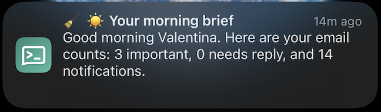

# Tidi 🧹

**Tidi** (from "tidy") is a small personal agent, in the spirit of Meta's Muse, that keeps your Gmail tidy and alerts your phone. It runs on free AI models.

<p align="center">
  
  <br><em>Tidi running and reporting to an iPhone through the ntfy app</em>
</p>

<p align="center">
  
  <br><em>The morning brief: a quick count of what came in overnight</em>
</p>

## What it does

**Every 3 hours** (you can change this)
- Reads new unread email.
- Uses AI to sort each one: Important, Needs reply, Newsletter, Promotion, Notification, Other.
- Labels it in Gmail (`Tidi/...`) and archives bulk mail. Nothing is deleted; archived mail stays in "All Mail".
- Writes reply drafts and saves them in **Gmail Drafts**. It never sends a reply for you.
- **Sends a phone alert only if something important or needing a reply arrived.** If it was only newsletters and promotions, it stays quiet.

**Every morning**
- Sends a brief covering everything since yesterday's brief.
- Asks you, with ✅ Unsubscribe / Keep buttons, before leaving any mailing list.

**Any time**, you can send `check` (check now), `brief` (summary now) or `help`.

## How it alerts you

Pick one with `NOTIFY_VIA` in `.env`:

| Option | What you install | Notes |
|---|---|---|
| `ntfy` (default) | The free **ntfy** app for Android or iPhone (search "ntfy" in your app store, or see https://ntfy.sh) | Normal phone notifications with tap buttons. No account needed. |
| `telegram` | Telegram plus a bot from @BotFather | Messages in a Telegram chat. |

## Files

| File | What it is |
|---|---|
| `run.sh` | Starts Tidi and keeps the Mac awake. **Run this.** |
| `tidi.py` | The main program, schedule and self-test. |
| `core.py` | What Tidi does with your mail: sorting, labels, drafts, alert text, brief. |
| `notify.py` | Sending alerts and receiving your taps (ntfy or Telegram). |
| `gmail_client.py` | Reads, labels, archives, drafts and unsubscribes in Gmail. |
| `brain.py` | The AI prompts. Works with Gemini, Groq, Ollama and others. |
| `store.py` | Tidi's memory (`state.json`), so nothing is handled twice. |
| `.env.example` | Settings template. Copy it to `.env`. |

## Setup (about 20 minutes)

### 1. Install Python packages
You need Python 3.10 or newer.
```bash
cd tidi
python -m venv venv
source venv/bin/activate        # Windows: venv\Scripts\activate
pip install -r requirements.txt
cp .env.example .env            # Windows: copy .env.example .env
```

### 2. Choose a free AI provider
Set `AI_PROVIDER` and `AI_API_KEY` in `.env`:

| Provider | Cost | Setup | Good to know |
|---|---|---|---|
| `gemini` (default) | Free tier | Get a key at https://aistudio.google.com/apikey | Easiest and most generous. On the free tier, Google may use what you send to improve its products, and that includes your emails' text. |
| `groq` | Free tier | Get a key at https://console.groq.com/keys | Very fast. Smaller daily limits; if you hit them, lower `BATCH_SIZE` or `MAX_EMAILS`. |
| `ollama` | Free, fully private | Install from https://ollama.com, then run `ollama pull llama3.1:8b` | Runs on your own computer, so emails never leave it. Needs about 8 GB of RAM and is slower. |

Paid options (`claude`, `openai`, `openrouter`) also work. Free-tier limits and model names change over time; if a model stops working, set `AI_MODEL` to a current one from the provider's website.

### 3. Allow access to Gmail
1. Go to https://console.cloud.google.com and create a project.
2. **APIs & Services → Library** → enable **Gmail API**.
3. **APIs & Services → OAuth consent screen** → choose **External**, fill in the app name and your email, and add your Gmail address under **Test users**.
4. **APIs & Services → Credentials → Create credentials → OAuth client ID** → type **Desktop app**.
5. Download the JSON file, rename it to `credentials.json`, and put it in the `tidi` folder.

### 4a. Phone alerts with ntfy (default)
1. Install the **ntfy** app on your phone.
2. Run Tidi (step 5). It prints a line like:
   ```
   In the ntfy app, subscribe to this topic:  tidi-51d4ea40b76c190d
   ```
3. In the app, tap **+**, enter that topic name, and subscribe. Leave the server as `ntfy.sh`.
4. You'll get a "Tidi is running" notification.

To send a command, open the topic `<your topic>-replies` in the app (subscribe to it too, or use the publish button) and send `check`, `brief` or `help`. Every alert also has a **Check now** button.

### 4b. Or Telegram alerts
1. In Telegram, open **@BotFather**, send `/newbot` and copy the token.
2. In `.env` set `NOTIFY_VIA=telegram` and `TELEGRAM_BOT_TOKEN=...`.
3. Run Tidi, send `/start` to your bot and it replies with your chat id. Put it in `.env` as `TELEGRAM_CHAT_ID` and restart.

### 5. Run it
```bash
bash run.sh --test    # check everything first
bash run.sh           # start Tidi
```
The first time, a browser window opens asking you to allow Gmail access. Approve it; this creates `token.json`. Tidi does its first check right away.

## Settings you might change (`.env`)
- `CHECK_EVERY_HOURS=3`: how often to check. Use `0` for the morning brief only.
- `BRIEF_TIME=07:30` and `TIMEZONE=...`: when the brief arrives.
- `MAX_UNSUB_QUESTIONS=5`: how many "Unsubscribe?" questions per morning.

## Self-test
```bash
bash run.sh --test
```
This checks your settings, the AI connection, Gmail access and phone alerts, and shows ✅ or ❌ with what to fix. It never changes your email.

## Troubleshooting
| You see | What to do |
|---|---|
| "the AI key was rejected (401)" | Create a new key at https://aistudio.google.com/apikey and paste it into `AI_API_KEY`. If new Gemini keys keep failing, switch to Groq: `AI_PROVIDER=groq` with a key from https://console.groq.com/keys. |
| "model … wasn't found" | Set `AI_MODEL` to a current model name from the provider's website. |
| "free AI limit was reached" | Wait, or lower `BATCH_SIZE` / `MAX_EMAILS`. |
| "Google sign-in expired" | `rm token.json`, then start Tidi again and sign in. |
| No alerts at all | Run the self-test. Tidi only sorts **unread** email; if everything is already read, there's nothing to do. |

Everything Tidi does is also written to `tidi.log` in the folder.

## Run it in the cloud with GitHub Actions (works when your computer is off)
The workflow in `.github/workflows/tidi.yml` runs Tidi every 3 hours, plus at about 07:30 for the morning brief, on GitHub's servers. It's free for a private repo within GitHub's monthly minutes (each run takes about 1 to 3 minutes).

1. **Use only one copy of Tidi.** If it runs on your Mac too, stop it: `bash service.sh uninstall`.
2. **Fix your ntfy topic in `.env`**, so cloud alerts go to the topic you're subscribed to: `NTFY_TOPIC=tidi-xxxxxxxxxxxx`.
3. **Add secrets** in your repo: **Settings → Secrets and variables → Actions → New repository secret**. On a Mac, `pbcopy < file` copies a file so you can paste it:

   | Secret name | Paste the contents of | Copy command |
   |---|---|---|
   | `TIDI_ENV` | `.env` | `pbcopy < .env` |
   | `GMAIL_CREDENTIALS` | `credentials.json` | `pbcopy < credentials.json` |
   | `GMAIL_TOKEN` | `token.json` | `pbcopy < token.json` |
   | `TIDI_STATE` (optional) | `state.json`, so Tidi remembers what it already handled | `pbcopy < state.json` |

4. **Test it:** **Actions → Tidi → Run workflow**. In a minute or two you get a "🧹 Tidi check done" notification.

Good to know:
- Taps on **Unsubscribe**, **Keep** and **Check now** are handled at the next run, not instantly.
- Secrets are encrypted by GitHub and never appear in the repo or the logs.
- Google may end the sign-in after 7 days while your Google app is in **Testing** mode. Tidi then alerts you. Sign in again on your Mac (`rm token.json`, then `bash run.sh --test`) and paste the new `token.json` into the `GMAIL_TOKEN` secret. To try to avoid this, open **Google Auth Platform → Audience** and click **Publish app**. For a personal, unverified app with Gmail access, Google may still limit how long the sign-in lasts.
- After changing `.env`, update the `TIDI_ENV` secret too.

## Keeping it running on your Mac
Tidi only works while it's running. If you close the terminal, or the Mac sleeps or shuts down, it stops.
- **On your Mac, in the background:** `bash service.sh install`. Tidi then runs without VS Code or a terminal, starts every time you log in, and restarts itself if it crashes. Use `bash service.sh status`, `logs`, `restart`, `stop` or `uninstall` to manage it. After changing code or `.env`, run `bash service.sh restart`.
- **On your Mac, in a terminal:** `bash run.sh`. It stops when you close the terminal.
- Either way the Mac must stay on and awake: keep it plugged in with the lid open. Tidi asks macOS not to sleep while it runs.
- Leave it running on a computer that stays on.
- Run it on a cheap cloud server (a $5/month VPS, Railway, Render, Fly.io). Copy the folder, **including `token.json` and `state.json`**, and start it with `nohup python tidi.py &` or a systemd service.

## Safety and privacy
- **Replies are drafts only.** You read and send them yourself.
- **Unsubscribing needs your tap.** It uses the sender's official `List-Unsubscribe` header. If the sender only offers a web link, Tidi sends you the link instead of opening it.
- **Email content is treated as untrusted.** The AI is told never to follow instructions written inside an email.
- **Nothing is deleted.** Archiving just removes the Inbox label.
- **About ntfy:** anyone who knows your topic name can read your alerts and send commands, so Tidi makes a long random one. Don't share it. Alerts pass through the public ntfy.sh server; for full privacy, self-host ntfy or use an access token (`NTFY_TOKEN`).
- Keep `.env`, `credentials.json`, `token.json` and `state.json` private. Don't upload them to GitHub.
